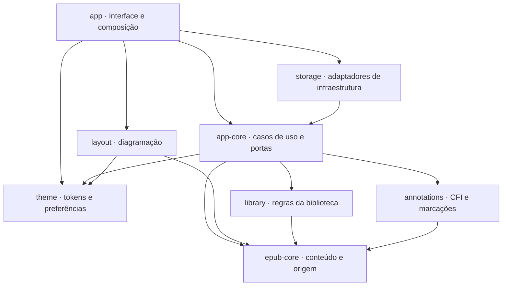

# Tournepage — Especificação de Desenvolvimento

Oct 18, 2026 · @Bruno Vaz

## 1. Visão geral

O Tournepage é um aplicativo desktop nativo para macOS, Windows e Linux que organiza uma pasta de EPUBs numa biblioteca e abre cada livro no mesmo modo leitura do plugin [L'Essentiel](https://github.com/BrunodosSantosVaz/lessentiel), com destaques, notas e marcadores no padrão de mercado.

O programa descarta toda a formatação da editora. Do EPUB ficam apenas o texto, as imagens e a marcação do que cada trecho é (título, parágrafo, citação, nota, lista, tabela). O renderizador próprio desenha esse conteúdo conforme as preferências do leitor.

### Objetivos

- **Leitura sem ruído:** a aparência é decidida pelo leitor, nunca pela editora.
- **Mesma experiência do plugin:** temas, fontes e espaçamentos vêm dos mesmos tokens de design do L'Essentiel.
- **Biblioteca automática:** o usuário aponta uma pasta; o programa encontra, cataloga e organiza os livros por autor, série, gênero e outros critérios.
- **Marcações duráveis:** destaques e notas sobrevivem a qualquer mudança de fonte, tamanho ou layout, e à troca de local ou de nome do arquivo.
- **Leve:** binário nativo, sem webview e sem Chromium.

### Princípios

1. **Texto em primeiro lugar.** Toda decisão de interface é julgada pelo conforto de leitura.
2. **Local e privado.** Nada sai da máquina: sem conta, sem nuvem, sem telemetria.
3. **O original é intocável.** O programa nunca altera, move ou apaga um arquivo EPUB.
4. **Rápido por padrão.** Abrir a biblioteca e abrir um livro devem parecer instantâneos.
5. **Robusto com livros ruins.** Um EPUB malformado nunca derruba o programa.

## 2. Escopo

A versão 1.0 lê EPUB 2 e EPUB 3 sem DRM, organiza a biblioteca a partir de pastas e oferece leitura personalizável com marcações. Tudo o que não está na lista abaixo está fora da versão 1.0.

### Dentro do escopo (v1.0)

- Leitura de EPUB 2 e EPUB 3 reflowable, sem DRM.
- Conversão de **todos os elementos** de conteúdo do EPUB para o modelo próprio (anexo na seção 9).
- Biblioteca alimentada por uma ou mais pastas monitoradas.
- Organização por autor, série, gênero/assunto, idioma, editora, ano e estado de leitura.
- Correção local de metadados (sem alterar o arquivo).
- Modo leitura paginado e em rolagem contínua, com as personalizações do plugin.
- Destaques, sublinhados, notas, marcadores, painel de marcações, exportação e importação.
- Busca na biblioteca e no texto do livro aberto.
- Interface em português (Brasil) e inglês.

### Fora do escopo (o que o produto não tem)

| Item | Comportamento na v1.0 | Futuro? |
| --- | --- | --- |
| Livros com DRM (Adobe ADEPT, Readium LCP, Apple FairPlay, Kindle) | Aparecem na biblioteca como "Protegido" e não abrem | Não |
| Outros formatos: PDF, MOBI/AZW, CBZ/CBR, FB2, DOCX | Ignorados na varredura | Não planejado |
| CSS, fontes, cores e scripts da editora | Sempre descartados | Não |
| EPUB de layout fixo (quadrinhos, livros infantis ilustrados) | Abre em reflow, com aviso de que o layout original se perde | Modo de layout fixo, talvez |
| Áudio, vídeo, iframes e formulários | Mostra o conteúdo alternativo; sem ele, um bloco discreto "conteúdo interativo indisponível" | Áudio e vídeo, talvez |
| Media overlays (narração sincronizada) | Ignorados | Talvez |
| Fórmulas MathML com tipografia matemática | Mostra o texto alternativo (`alttext`) ou o texto da fórmula | Sim |
| Texto vertical (CJK) | Exibido na horizontal | Talvez |
| Leitura em voz alta (TTS) | Não existe | Sim |
| Dicionário e tradução | Não existe | Dicionário offline |
| Edição do conteúdo ou dos metadados dentro do arquivo | Não existe; correções ficam só no banco do programa | Não |
| Conta, nuvem, sincronização entre dispositivos | Não existe | Não planejado |
| Loja, recomendações, recursos sociais | Não existe | Não |
| Aplicativos para celular e tablet | Não existe | Talvez |
| Impressão e conversão de formatos | Não existe | Não |
| Telemetria e coleta de uso | Não existe | Não |

## 3. Glossário e personas

### Glossário

| Termo | Significado neste projeto |
| --- | --- |
| EPUB | Livro digital: um ZIP com páginas XHTML, imagens e arquivos de controle |
| OPF | Arquivo de pacote do EPUB: metadados, lista de arquivos (manifest) e ordem de leitura (spine) |
| Spine | Sequência de documentos XHTML que formam o livro, na ordem de leitura. Cada item é um **capítulo** para o programa |
| Nav / NCX | Sumário do livro: `nav.xhtml` no EPUB 3, `toc.ncx` no EPUB 2 |
| Modelo de conteúdo | Representação própria do capítulo em **blocos** (parágrafo, título, lista…) e **inlines** (texto, ênfase, link…), sem nenhuma formatação da editora |
| Localizador de origem | Caminho de cada trecho do modelo até o ponto exato no XHTML original. É o que permite gerar CFIs |
| EPUB CFI | Canonical Fragment Identifier: endereço padrão de um ponto ou trecho do livro (ex.: `epubcfi(/6/14!/4/2/10,/1:12,/1:48)`) |
| Posição | Unidade estável de progresso: uma posição a cada 1.024 caracteres de texto, independente da fonte e da janela |
| Página impressa | Número de página da edição em papel, quando o EPUB traz `page-list` |
| Destaque | Trecho marcado pelo usuário com uma cor (ou sublinhado) |
| Nota do usuário | Comentário escrito pelo usuário, ligado a um destaque ou a uma posição |
| Nota do livro | Nota de rodapé ou de fim que já vem no EPUB. **Não confundir com nota do usuário** |
| Marcador | Posição salva pelo usuário para voltar depois |
| Marcação | Termo geral para destaque, nota do usuário ou marcador |
| Pasta monitorada | Pasta que o programa acompanha para encontrar livros novos, alterados e removidos |
| Sobreposição de metadados | Correção feita pelo usuário (gênero, série, título) guardada no banco e exibida no lugar do valor do arquivo |
| Tokens de design | Valores nomeados de cor, tipografia, espaço e movimento, compartilhados com o plugin |

### Personas

- **Leitora assídua.** Lê romances e não ficção por horas. Quer conforto visual, tema escuro à noite, uma biblioteca organizada por série e autor, e retomar a leitura exatamente de onde parou.
- **Estudante ou pesquisador.** Lê livros técnicos e acadêmicos. Destaca muito, escreve notas, consulta notas de rodapé o tempo todo e exporta citações com referência para os seus trabalhos.
- **Leitor com necessidades de acessibilidade.** Tem dislexia ou baixa visão. Precisa de fonte específica, espaçamento largo, alto contraste, navegação só por teclado e compatibilidade com leitor de tela.

## 4. Requisitos funcionais

São 74 requisitos em sete módulos. Prioridade: **Essencial** (sem ele não há versão 1.0), **Importante** (entra na 1.0 se o prazo permitir) e **Desejável** (pode ficar para depois).

### 4.1 Biblioteca (BIB)

| ID | Requisito | Prioridade |
| --- | --- | --- |
| RF-BIB-01 | Adicionar e remover pastas da biblioteca | Essencial |
| RF-BIB-02 | Varrer as pastas recursivamente e encontrar todos os arquivos `.epub` | Essencial |
| RF-BIB-03 | Monitorar as pastas: livros novos, alterados, removidos, movidos ou renomeados | Essencial |
| RF-BIB-04 | Extrair metadados: título, subtítulo, autores e colaboradores com papel, série e volume, gêneros/assuntos, idioma, editora, data, identificador (ISBN/UUID), descrição e capa | Essencial |
| RF-BIB-05 | Exibir a biblioteca em grade de capas e em lista | Essencial |
| RF-BIB-06 | Agrupar por autor, série, gênero/assunto, idioma, editora, ano e estado de leitura | Essencial |
| RF-BIB-07 | Ordenar por título, autor, data de adição, última leitura, progresso e ano | Essencial |
| RF-BIB-08 | Filtrar combinando critérios e buscar por texto em título, autor, série e descrição | Essencial |
| RF-BIB-09 | Estados de leitura: Não lido, Lendo, Lido, Abandonado, com mudança automática e manual | Essencial |
| RF-BIB-10 | Seção "Continuar lendo" com os livros abertos recentemente | Essencial |
| RF-BIB-11 | Página de detalhes do livro: capa, metadados, sinopse, progresso, número de marcações, local do arquivo | Essencial |
| RF-BIB-12 | Corrigir metadados localmente: título, autores, série, volume, gêneros, idioma | Importante |
| RF-BIB-13 | Coleções (prateleiras) criadas pelo usuário | Importante |
| RF-BIB-14 | Mostrar livros protegidos (DRM) e corrompidos com o motivo | Essencial |
| RF-BIB-15 | Detectar duplicados e edições diferentes do mesmo livro | Importante |
| RF-BIB-16 | Mostrar o arquivo no gerenciador de arquivos do sistema | Importante |
| RF-BIB-17 | Gerar capa substituta (título e autor) quando o livro não tem capa | Essencial |

### 4.2 Importação e conteúdo (IMP)

| ID | Requisito | Prioridade |
| --- | --- | --- |
| RF-IMP-01 | Ler EPUB 2 e EPUB 3: `container.xml`, OPF, `nav.xhtml` e `toc.ncx` | Essencial |
| RF-IMP-02 | Converter cada documento da spine para o modelo de conteúdo, cobrindo todos os elementos do anexo da seção 9 | Essencial |
| RF-IMP-03 | Descartar CSS, fontes, estilos em linha, cores e scripts da editora | Essencial |
| RF-IMP-04 | Preservar a semântica de `epub:type` e `role="doc-*"` | Essencial |
| RF-IMP-05 | Ler XHTML malformado com um parser HTML5 tolerante | Essencial |
| RF-IMP-06 | Guardar o localizador de origem de cada trecho para gerar CFIs | Essencial |
| RF-IMP-07 | Ler imagens JPEG, PNG, GIF, WebP e SVG | Essencial |
| RF-IMP-08 | Identificar e indexar as notas do livro (rodapé, fim de capítulo, fim de livro) | Essencial |
| RF-IMP-09 | Ler o sumário hierárquico, os landmarks e a lista de páginas impressas | Essencial |
| RF-IMP-10 | Guardar em cache o modelo convertido para abrir mais rápido na próxima vez | Importante |

### 4.3 Leitura (LEI)

| ID | Requisito | Prioridade |
| --- | --- | --- |
| RF-LEI-01 | Abrir o livro na última posição lida | Essencial |
| RF-LEI-02 | Modo paginado em colunas (1 por padrão, escolhidas com + e −; RN-29) e modo rolagem contínua | Essencial |
| RF-LEI-03 | Navegar por teclado, clique nas margens, roda do mouse, gestos de trackpad e barra de progresso | Essencial |
| RF-LEI-04 | Sumário lateral com o capítulo atual destacado | Essencial |
| RF-LEI-05 | Abrir notas do livro em pop-up, sem perder a posição | Essencial |
| RF-LEI-06 | Seguir links internos com histórico de voltar e avançar | Essencial |
| RF-LEI-07 | Abrir links externos no navegador padrão, após confirmação | Essencial |
| RF-LEI-08 | Mostrar progresso: porcentagem, capítulo, posição, página impressa (se houver) e tempo restante estimado | Essencial |
| RF-LEI-09 | Abrir imagem em tela cheia com zoom | Importante |
| RF-LEI-10 | Rolar horizontalmente tabelas mais largas que a coluna | Essencial |
| RF-LEI-11 | Modo foco em tela cheia, com a interface escondida | Essencial |
| RF-LEI-12 | Rolagem automática com velocidade ajustável | Importante |
| RF-LEI-13 | Ir para porcentagem, posição ou página impressa | Importante |
| RF-LEI-14 | Selecionar e copiar texto, com opção de incluir a referência | Essencial |

### 4.4 Personalização (PER)

Mesmo conjunto de controles do plugin L'Essentiel, com pré-visualização ao vivo.

| ID | Requisito | Prioridade |
| --- | --- | --- |
| RF-PER-01 | Temas: Automático (segue o sistema), Claro, Papel, Sépia, Escuro, Grafite e Noite, mais temas personalizados (seção 12.3) | Essencial |
| RF-PER-02 | Fonte de leitura: fontes incluídas no programa e fontes do sistema | Essencial |
| RF-PER-03 | Tamanho da fonte, altura da linha, espaço entre letras, palavras e parágrafos | Essencial |
| RF-PER-04 | Alinhamento à esquerda, centralizado, à direita ou justificado, com hifenização ligada ou desligada | Essencial |
| RF-PER-05 | Largura da coluna de texto e margens | Essencial |
| RF-PER-06 | Recuo da primeira linha do parágrafo, ou espaço entre parágrafos | Importante |
| RF-PER-07 | Mostrar ou esconder imagens | Essencial |
| RF-PER-08 | Preferências globais, com exceções salvas por livro | Importante |
| RF-PER-09 | Importar as preferências exportadas do plugin | Desejável |
| RF-PER-10 | Número de colunas no modo paginado, com botões + e − (RN-29) | Essencial |

### 4.5 Marcações (MAR)

| ID | Requisito | Prioridade |
| --- | --- | --- |
| RF-MAR-01 | Destacar a seleção em cinco cores: amarelo, verde, azul, rosa e roxo | Essencial |
| RF-MAR-02 | Sublinhar como estilo alternativo ao destaque | Importante |
| RF-MAR-03 | Escrever nota ligada a um destaque | Essencial |
| RF-MAR-04 | Criar marcador na posição atual, com nome e nota opcionais | Essencial |
| RF-MAR-05 | Editar cor e nota; excluir com desfazer | Essencial |
| RF-MAR-06 | Painel de marcações do livro: em ordem de leitura, com filtro por tipo e cor, busca e navegação ao clicar | Essencial |
| RF-MAR-07 | Visão geral com as marcações de todos os livros | Importante |
| RF-MAR-08 | Etiquetas nas marcações | Desejável |
| RF-MAR-09 | Exportar marcações em Markdown e em JSON (W3C Web Annotation) | Essencial |
| RF-MAR-10 | Importar marcações em JSON (W3C Web Annotation) | Importante |
| RF-MAR-11 | Copiar citação com referência: autor, título e capítulo | Importante |
| RF-MAR-12 | Manter as marcações após mudança de preferências, reabertura e troca de local ou nome do arquivo | Essencial |
| RF-MAR-13 | Lixeira de marcações excluídas, com restauração | Importante |

### 4.6 Busca (BUS)

| ID | Requisito | Prioridade |
| --- | --- | --- |
| RF-BUS-01 | Buscar no texto do livro aberto, com lista de resultados e trecho de contexto | Essencial |
| RF-BUS-02 | Ignorar acentos e maiúsculas na busca, com opção de diferenciar | Essencial |
| RF-BUS-03 | Navegar entre resultados e destacá-los no texto | Essencial |
| RF-BUS-04 | Buscar no texto de todos os livros da biblioteca | Desejável |

### 4.7 Configurações (CFG)

| ID | Requisito | Prioridade |
| --- | --- | --- |
| RF-CFG-01 | Gerenciar as pastas monitoradas | Essencial |
| RF-CFG-02 | Idioma da interface: português (Brasil) e inglês | Essencial |
| RF-CFG-03 | Tema da interface: seguir o sistema, claro ou escuro | Essencial |
| RF-CFG-04 | Ver e personalizar atalhos de teclado | Importante |
| RF-CFG-05 | Fazer e restaurar cópia de segurança do banco (marcações, progresso, preferências) | Essencial |
| RF-CFG-06 | Verificar atualizações, desligado por padrão | Desejável |

## 5. Regras de negócio

As regras abaixo valem para todo o sistema e têm precedência sobre detalhes de implementação.

### 5.1 Arquivos e identidade do livro

- **RN-01 — Original intocável.** O programa nunca altera, move, renomeia ou apaga um arquivo EPUB. "Remover da biblioteca" só remove o registro.
- **RN-02 — Identidade por conteúdo.** Um livro é identificado pelo hash BLAKE3 do arquivo. Mover ou renomear o arquivo mantém progresso, marcações e correções de metadados.
- **RN-03 — Nova versão do mesmo livro.** Se o arquivo mudar de conteúdo, mas mantiver o mesmo identificador do OPF, é tratado como nova versão: as marcações são migradas (RN-23) e as que não puderem ser recolocadas ficam como **órfãs**, nunca apagadas.
- **RN-04 — Duplicados.** Arquivos com o mesmo hash são um único livro com vários caminhos. Mesmo identificador com hash diferente são edições distintas, agrupadas e exibidas separadamente.
- **RN-05 — Pasta removida.** Os livros da pasta saem da biblioteca, mas progresso, marcações e correções ficam guardados e reaparecem se o mesmo arquivo voltar.
- **RN-06 — Livro protegido.** Um livro é "Protegido" quando `META-INF/encryption.xml` cifra algum recurso com algoritmo diferente da ofuscação de fontes (IDPF ou Adobe), ou quando há licença LCP ou `rights.xml`. Ele aparece na biblioteca e não abre.
- **RN-07 — Livro corrompido.** ZIP ou OPF ilegível marca o livro como "Erro", com o motivo. O programa tenta de novo quando o arquivo mudar.

### 5.2 Metadados

- **RN-08 — Título.** Usa o `dc:title` principal (`title-type="main"` ou o primeiro). Sem título, usa o nome do arquivo sem extensão.
- **RN-09 — Autor.** `dc:creator` com papel `aut`, ou sem papel, é autor. Outros papéis (`trl` tradutor, `ill` ilustrador, `edt` organizador) são colaboradores e não agrupam como autor. A ordenação usa `file-as`; sem ele, "Nome Sobrenome" vira "Sobrenome, Nome".
- **RN-10 — Gênero/assunto.** Vem de `dc:subject`, com vários por livro. Para agrupar, compara sem acentos e sem maiúsculas e exibe a grafia mais frequente. Livro sem assunto entra em "Sem gênero".
- **RN-11 — Série.** Vem de `belongs-to-collection` com `collection-type="series"` (EPUB 3) ou de `calibre:series` (EPUB 2). O volume vem de `group-position` ou `calibre:series_index`.
- **RN-12 — Capa.** Ordem de busca: item com `properties="cover-image"`; `<meta name="cover">`; referência `cover` do guide; primeira imagem do primeiro documento. Sem nenhuma, gera capa com título e autor nas cores do tema.
- **RN-13 — Correção local prevalece.** Um metadado corrigido pelo usuário substitui o do arquivo em toda a interface, até o usuário desfazer a correção.

### 5.3 Conteúdo e exibição

- **RN-14 — Sem formatação da editora.** Nenhum atributo de apresentação do livro é usado: CSS, `style`, `align`, `font`, cores, fontes embutidas. O renderizador usa só o tipo do elemento, a semântica e as preferências do leitor.
- **RN-15 — Conteúdo não suportado.** Áudio, vídeo, iframe, formulários e scripts são trocados pelo conteúdo alternativo do próprio livro. Sem alternativa, aparece um bloco discreto "conteúdo interativo indisponível".
- **RN-16 — Notas do livro.** Uma chamada de nota (`noteref` ou `doc-noteref`) abre a nota em pop-up. Links sem semântica, mas com texto numérico ou sobrescrito apontando para um trecho curto, também abrem em pop-up. Notas `aside` referenciadas ficam fora do fluxo do texto; listas de notas de fim continuam visíveis no lugar original.
- **RN-17 — Imagens desligadas.** Cada imagem vira um marcador discreto com o texto alternativo, que abre a imagem ao clicar.
- **RN-18 — Layout fixo.** EPUB com `rendition:layout="pre-paginated"` abre em reflow e mostra um aviso uma vez por livro.
- **RN-19 — Links externos.** Abrem no navegador padrão, depois de uma confirmação que mostra o endereço completo.

* **RN-29 — Colunas.** No modo paginado, o texto ocupa 1 coluna por padrão, e o leitor aumenta ou diminui com os botões + e − no painel de aparência. Cada coluna mantém pelo menos 45 caracteres por linha (token `measure-min`), então o máximo depende da largura da janela e do tamanho da fonte; no limite, o botão + fica desativado. Se a janela estreitar, o programa mostra menos colunas sem mudar a preferência e volta ao número escolhido quando houver espaço. No modo rolagem contínua, o texto usa sempre 1 coluna.

### 5.4 Progresso e estados de leitura

- **RN-20 — Posição salva.** A posição de leitura é salva como CFI a cada mudança de página ou parada de rolagem (até 2 s depois) e ao fechar o livro.
- **RN-21 — Progresso estável.** A porcentagem e a "posição" são calculadas sobre o texto (1 posição = 1.024 caracteres), não sobre páginas, para não mudar quando a fonte ou a janela mudam. A página impressa só aparece quando o livro traz `page-list`.
- **RN-22 — Estados automáticos.** "Não lido" vira "Lendo" ao avançar além de 1% do texto. "Lendo" vira "Lido" ao atingir 98% do texto do corpo do livro. Um estado escolhido manualmente prevalece sobre a regra automática.

### 5.5 Marcações

- **RN-23 — Âncora dupla.** Toda marcação guarda o CFI do trecho e uma citação de texto (32 caracteres antes, o trecho, 32 caracteres depois). Ao abrir, tenta o CFI e confere a citação. Se não bater, procura a citação no capítulo. Se não achar, a marcação vira órfã e aparece no painel com aviso.
- **RN-24 — Limites do destaque.** Mínimo de 1 caractere. Um destaque não atravessa capítulos: a seleção é limitada ao capítulo onde começou.
- **RN-25 — Sobreposição.** Destaques podem se sobrepor. O mais recente é desenhado por cima, e clicar numa área sobreposta lista todos os destaques daquele ponto.
- **RN-26 — Exclusão.** Excluir mostra "Desfazer" por 10 s. Depois, a marcação vai para a lixeira, onde fica 30 dias antes de ser apagada de vez.
- **RN-27 — Conteúdo da exportação.** Cada marcação exportada traz: livro, autor, capítulo, posição, data de criação, cor, trecho destacado e nota.
- **RN-28 — Preferências.** Valem para todos os livros; uma exceção salva para um livro tem precedência apenas naquele livro.

## 6. Casos de uso

O único ator humano é o **Leitor** (usuário). O **Sistema de arquivos** é ator secundário nos casos de sincronização.

### UC-01 — Configurar a biblioteca na primeira execução

**Pré-condição:** programa instalado, banco vazio.

1. O sistema mostra a tela de boas-vindas com o botão "Escolher pasta de livros".
2. O leitor escolhe uma pasta no diálogo do sistema.
3. O sistema varre a pasta em segundo plano e mostra os livros conforme são encontrados, com a contagem atualizada.
4. Ao terminar, o sistema mostra a biblioteca em grade, ordenada por data de adição.

**Alternativos:** 2a. O leitor cancela o diálogo: a tela de boas-vindas continua. 3a. A pasta não tem EPUBs: mensagem "Nenhum livro encontrado" com opção de escolher outra pasta.

**Exceções:** 3b. Sem permissão de leitura na pasta: mensagem com o caminho e o motivo; a pasta não é adicionada.

### UC-02 — Sincronizar mudanças na pasta

**Ator:** Sistema de arquivos. **Pré-condição:** ao menos uma pasta monitorada.

1. Um arquivo `.epub` é criado, alterado, removido ou movido dentro da pasta.
2. O sistema aguarda o arquivo ficar estável (sem mudar de tamanho por 2 s).
3. O sistema calcula o hash e aplica a mudança: novo livro, nova versão (RN-03), caminho atualizado (RN-02) ou remoção.
4. A biblioteca é atualizada sem recarregar a tela.

**Alternativos:** 1a. A mudança acontece com o programa fechado: a reconciliação roda na próxima abertura. 3a. Arquivo protegido ou corrompido: registrado com o estado correspondente (RN-06, RN-07).

### UC-03 — Encontrar um livro na biblioteca

1. O leitor escolhe agrupar (ex.: por gênero), ordenar e filtrar (ex.: idioma português, estado "Não lido").
2. O leitor digita parte do título ou do autor na busca.
3. O sistema atualiza a lista a cada tecla.
4. O leitor abre o livro (UC-05) ou a página de detalhes.

**Alternativo:** 3a. Nenhum resultado: mensagem com o botão "Limpar filtros".

### UC-04 — Corrigir metadados de um livro

1. Na página de detalhes, o leitor escolhe "Editar informações".
2. O sistema mostra os campos com os valores atuais e, ao lado, o valor original do arquivo.
3. O leitor altera, por exemplo, o gênero de "Sem gênero" para "Ficção científica" e salva.
4. O sistema grava a sobreposição (RN-13) e reagrupa a biblioteca.

**Alternativo:** 3a. O leitor escolhe "Restaurar original" num campo: a sobreposição é apagada.

### UC-05 — Abrir e ler um livro

1. O leitor abre um livro pela biblioteca.
2. O sistema carrega o modelo do cache (ou converte o EPUB) e abre na última posição (RN-20).
3. O leitor avança e volta páginas, usa o sumário e a barra de progresso.
4. O sistema salva a posição continuamente e atualiza o estado de leitura (RN-22).
5. O leitor fecha o livro; o sistema volta para a biblioteca.

**Alternativos:** 2a. Primeira abertura: começa no início do corpo do livro (landmark `bodymatter`), ou no primeiro item da spine. 2b. Livro de layout fixo: aviso de RN-18. 3a. O leitor clica num link interno: o sistema navega e oferece "Voltar". 3b. Link externo: confirmação de RN-19.

**Exceções:** 2c. Arquivo sumiu do disco: mensagem "Arquivo não encontrado" com opção de localizar; progresso e marcações continuam guardados. 2d. Livro protegido: mensagem explicando que livros com DRM não são suportados.

### UC-06 — Personalizar a leitura

1. Com um livro aberto, o leitor abre o painel "Aparência".
2. O leitor muda tema, fonte, tamanho, espaçamento, alinhamento ou largura.
3. O sistema aplica cada mudança na hora, mantendo a mesma frase no topo da tela.
4. O leitor fecha o painel; as preferências ficam salvas como globais.

**Alternativo:** 4a. O leitor marca "Só para este livro": a mudança vira exceção do livro (RN-28).

### UC-07 — Consultar uma nota do livro

1. O leitor clica numa chamada de nota no texto.
2. O sistema mostra a nota num pop-up ao lado da chamada.
3. O leitor lê e fecha o pop-up (Esc, clique fora ou botão).

**Alternativos:** 2a. A nota é longa: o pop-up rola e oferece "Ir para a nota", que navega até ela com "Voltar" disponível. 2b. O alvo não existe: o link é ignorado e um aviso discreto é exibido.

### UC-08 — Destacar um trecho e escrever uma nota

1. O leitor seleciona um trecho com o mouse, o teclado ou o toque.
2. O sistema mostra o menu de seleção: cinco cores, sublinhado, nota, copiar e copiar com referência.
3. O leitor escolhe uma cor; o sistema desenha o destaque e o salva (RN-23).
4. O leitor escolhe "Nota", escreve o comentário e confirma.
5. O sistema mostra um ícone de nota junto ao destaque.

**Alternativos:** 1a. A seleção atravessa capítulos: é limitada ao capítulo inicial (RN-24). 3a. O trecho já tem destaque: o menu mostra as opções de editar e excluir o existente.

### UC-09 — Revisar e gerenciar marcações

1. O leitor abre o painel de marcações.
2. O sistema lista as marcações em ordem de leitura, com capítulo, cor, trecho e nota.
3. O leitor filtra por tipo ou cor, ou busca por texto.
4. O leitor clica numa marcação; o sistema navega até ela e a realça por um instante.
5. O leitor edita a nota, troca a cor ou exclui (RN-26).

**Alternativo:** 2a. Há marcações órfãs: aparecem numa seção separada, com o trecho guardado e a opção de recolocá-las manualmente.

### UC-10 — Exportar marcações

1. No painel de marcações, o leitor escolhe "Exportar".
2. O leitor escolhe o formato (Markdown ou JSON) e o destino.
3. O sistema gera o arquivo com os campos de RN-27.

**Alternativo:** 1a. Exportação a partir da visão geral: um arquivo com todos os livros, ou um por livro.

### UC-11 — Buscar no livro

1. O leitor pressiona Ctrl/Cmd+F e digita o termo.
2. O sistema busca em todos os capítulos em segundo plano e lista os resultados com contexto, agrupados por capítulo.
3. O leitor escolhe um resultado; o sistema navega e destaca o termo.
4. O leitor percorre os próximos com Enter e Shift+Enter.

**Alternativo:** 2a. Nenhum resultado: mensagem "Nada encontrado".

## 7. Requisitos não funcionais

As metas de tempo valem para um computador de referência: SSD, 8 GB de RAM, processador de 2020 ou mais novo. São metas iniciais, a validar na fase de prova de conceito.

| ID | Área | Requisito | Meta |
| --- | --- | --- | --- |
| RNF-01 | Plataformas | macOS, Windows e Linux, com o mesmo código | macOS 12+ (Intel e Apple Silicon); Windows 10 22H2+ e 11 (x64 e ARM64); Linux x86\_64 e ARM64, glibc 2.35+, Wayland e X11 |
| RNF-02 | Dependências | Nenhum webview nem Chromium | Zero |
| RNF-03 | Tamanho | Instalador pequeno, já com as fontes incluídas | Até 30 MB |
| RNF-04 | Inicialização | Da abertura até a biblioteca visível, com 1.000 livros | Até 1 s |
| RNF-05 | Abrir livro | Da escolha até a primeira página, livro já indexado | Até 500 ms (1 MB de texto); até 1,5 s (10 MB) |
| RNF-06 | Fluidez | Virar página, rolar e animar | 60 quadros por segundo; 120 em telas que suportam |
| RNF-07 | Preferências | Mudança de fonte ou tamanho aplicada ao capítulo atual | Até 100 ms; o resto do livro em segundo plano |
| RNF-08 | Indexação | Varredura de pastas sem travar a interface | 20 livros/s ou mais; até 10.000 livros |
| RNF-09 | Memória | Uso com um livro aberto | Até 150 MB típico; até 300 MB no pior caso |
| RNF-10 | Robustez | Nenhum EPUB malformado derruba o programa | 0 falhas num corpus de 500+ EPUBs reais; parser testado com fuzzing |
| RNF-11 | Durabilidade | Marcações e progresso sobrevivem a queda de energia | Gravação confirmada até 1 s após a ação; SQLite em modo WAL; backup automático diário com 7 cópias |
| RNF-12 | Privacidade | Nenhuma conexão de rede por iniciativa do programa | Zero, exceto verificar atualização se o usuário ligar; sem telemetria |
| RNF-13 | Segurança | Conteúdo do EPUB tratado como não confiável | Sem execução de scripts; caminhos do ZIP validados; limite de descompactação (razão 100:1, 2 GB no total); limite de profundidade do XML; SVG sem scripts nem referências externas |
| RNF-14 | Acessibilidade | Interface usável por todos | WCAG 2.2 AA; 100% operável por teclado; leitor de tela (VoiceOver, Narrador, Orca); contraste 4,5:1 nos temas padrão; respeita "reduzir movimento" e a escala do sistema |
| RNF-15 | Idiomas do conteúdo | Texto de qualquer idioma exibido corretamente | Latim, cirílico, grego, árabe e hebraico (direita para a esquerda), CJK, indianos; hifenização nos idiomas com padrões disponíveis |
| RNF-16 | Idiomas da interface | Textos fora do código | Arquivos Fluent; pt-BR e en na 1.0 |
| RNF-17 | Manutenibilidade | Núcleo independente da interface | Crates de domínio sem dependência de UI; cobertura de testes de 80% no núcleo |
| RNF-18 | Licenças | Projeto aberto, dependências compatíveis | Código MIT; nenhuma dependência GPL ou AGPL, verificado no CI com `cargo-deny`; fontes com licença OFL |

## 8. Critérios de aceite

Cada critério segue o formato **Dado / Quando / Então** e deve virar um teste automatizado, exceto onde indicado "manual". Um requisito só está pronto quando todos os seus critérios passam nas três plataformas.

### 8.1 Biblioteca

| ID | Cobre | Dado | Quando | Então |
| --- | --- | --- | --- | --- |
| CA-01 | RF-BIB-02 | Uma pasta com 3 EPUBs na raiz e 2 em subpastas | O leitor adiciona a pasta | Os 5 livros aparecem na biblioteca |
| CA-02 | RF-BIB-03, RN-02 | Um livro com 4 destaques e progresso de 40% | O arquivo é movido para outra subpasta e renomeado | O livro continua com os 4 destaques e 40%, sem duplicar |
| CA-03 | RF-BIB-03 | Uma pasta monitorada com o programa aberto | Um EPUB novo é copiado para ela | O livro aparece em até 5 s, sem recarregar a tela |
| CA-04 | RN-01 | Qualquer operação do programa | Antes e depois, o hash dos arquivos é comparado | Nenhum arquivo EPUB foi alterado |
| CA-05 | RF-BIB-04, RN-09 | EPUB com `dc:creator` autor e tradutor | O livro é indexado | O agrupamento por autor mostra só o autor; o tradutor aparece nos detalhes como colaborador |
| CA-06 | RN-10 | Livros com assuntos "Ficção", "ficcao" e "FICÇÃO" | O leitor agrupa por gênero | Aparece um único grupo, com a grafia mais frequente |
| CA-07 | RN-10 | Livro sem `dc:subject` | O leitor agrupa por gênero | O livro está em "Sem gênero" |
| CA-08 | RN-11 | EPUB 3 com série e `group-position` 2, e EPUB 2 com `calibre:series` | Os livros são indexados | Ambos aparecem na série certa, como volume 2 |
| CA-09 | RF-BIB-12, RN-13 | Livro em "Sem gênero" | O leitor define o gênero "Fantasia" | O livro passa para "Fantasia" e o arquivo continua igual |
| CA-10 | RF-BIB-14, RN-06 | EPUB com Adobe DRM e EPUB só com fontes ofuscadas | Os dois são indexados | O primeiro aparece como "Protegido" e não abre; o segundo abre normalmente |
| CA-11 | RF-BIB-17, RN-12 | EPUB sem nenhuma imagem de capa | O livro é exibido na grade | Aparece uma capa gerada com título e autor |
| CA-12 | RNF-04 | Biblioteca com 1.000 livros indexados | O programa é aberto | A grade fica visível em até 1 s (medido no CI) |

### 8.2 Importação e conteúdo

| ID | Cobre | Dado | Quando | Então |
| --- | --- | --- | --- | --- |
| CA-13 | RF-IMP-02 | O EPUB de teste com todos os elementos do anexo | O livro é convertido | Cada elemento gera o tipo do modelo previsto no anexo (teste de snapshot) |
| CA-14 | RF-IMP-03, RN-14 | Capítulo com CSS que pinta o texto de vermelho e usa fonte embutida | O capítulo é exibido | O texto usa a cor e a fonte do tema do leitor |
| CA-15 | RF-IMP-05 | Capítulo com `&nbsp;` não declarado e tags sem fechar | O capítulo é aberto | O texto aparece completo, sem erro |
| CA-16 | RF-IMP-04 | `<aside epub:type="footnote">` e `<aside role="doc-footnote">` | Os capítulos são convertidos | As duas notas são reconhecidas da mesma forma |
| CA-17 | RNF-10 | Corpus de 500+ EPUBs reais e arquivos gerados por fuzzing | A suíte roda | Nenhuma falha ou travamento; arquivos ruins viram estado "Erro" |
| CA-18 | RNF-13 | Um EPUB "zip bomb" e um com caminho `../../etc/passwd` | Os arquivos são indexados | Os dois são recusados com estado "Erro", sem gravar nada fora do cache |

### 8.3 Leitura e personalização

| ID | Cobre | Dado | Quando | Então |
| --- | --- | --- | --- | --- |
| CA-19 | RF-LEI-01, RN-20 | Livro lido até o meio do capítulo 5 | O programa é fechado à força e reaberto | O livro abre no mesmo parágrafo do capítulo 5 |
| CA-20 | RF-LEI-05, RN-16 | Uma chamada de nota no texto | O leitor clica nela | A nota aparece em pop-up e a posição de leitura não muda |
| CA-21 | RF-LEI-06 | Um link interno para outro capítulo | O leitor clica e depois usa "Voltar" | O programa navega ao destino e volta exatamente ao ponto de origem |
| CA-22 | RF-LEI-07, RN-19 | Um link `https://` no texto | O leitor clica | Aparece confirmação com o endereço; nada abre sem confirmar |
| CA-23 | RN-21 | Livro em 37% com fonte 18 | O leitor muda para fonte 24 | O progresso continua 37% e a mesma frase segue visível |
| CA-24 | RF-PER-01 a 07, RNF-07 | Livro aberto | O leitor muda tema, fonte, tamanho, espaçamento, alinhamento e largura | Cada mudança aparece em até 100 ms |
| CA-25 | RF-PER-08, RN-28 | Fonte global 18 e exceção de 22 no livro A | O leitor abre o livro B | O livro B usa 18; o livro A continua com 22 |
| CA-26 | RNF-06 | Capítulo longo em modo paginado | O leitor vira 100 páginas seguidas | Nenhum quadro passa de 16 ms (medido) |
| CA-38 | RF-PER-10, RN-29 | Janela de 1.600 px, fonte 20, 1 coluna | O leitor clica em + duas vezes e depois estreita a janela para 800 px | Aparecem 3 colunas com pelo menos 45 caracteres por linha; com 800 px aparece 1; ao alargar de novo, voltam as 3 |

### 8.4 Marcações

| ID | Cobre | Dado | Quando | Então |
| --- | --- | --- | --- | --- |
| CA-27 | RF-MAR-01, RNF-11 | Um trecho selecionado | O leitor escolhe a cor verde | O destaque aparece e já está gravado no banco em até 1 s |
| CA-28 | RF-MAR-12, RN-23 | Um destaque criado com fonte 16, coluna estreita, modo paginado | O leitor muda para fonte 26, coluna larga, modo rolagem | O destaque cobre exatamente o mesmo texto |
| CA-29 | RN-03, RN-23 | Livro com 10 destaques; uma nova versão do arquivo insere um parágrafo antes deles | A nova versão é indexada | Os 10 destaques são recolocados pelo texto; nenhum se perde |
| CA-30 | RN-23 | Um destaque cujo trecho foi apagado numa nova versão | O livro é aberto | O destaque aparece como órfão no painel, com o texto guardado |
| CA-31 | RN-24 | Seleção que começa no fim do capítulo 2 e termina no capítulo 3 | O leitor destaca | Só a parte do capítulo 2 é destacada |
| CA-32 | RF-MAR-05, RN-26 | Um destaque excluído | O leitor clica em "Desfazer" em até 10 s | O destaque volta com cor e nota |
| CA-33 | RF-MAR-09, RN-27 | Livro com destaques e notas | O leitor exporta em JSON | O arquivo valida contra o esquema W3C Web Annotation e traz todos os campos de RN-27 |
| CA-34 | RF-MAR-10 | O JSON exportado no CA-33 | É importado numa instalação limpa com o mesmo livro | Todos os destaques aparecem nos mesmos trechos |

### 8.5 Acessibilidade e busca

| ID | Cobre | Dado | Quando | Então |
| --- | --- | --- | --- | --- |
| CA-35 | RNF-14 (manual) | Leitor de tela ligado (VoiceOver, Narrador, Orca) | O usuário navega pela biblioteca e lê um capítulo | Todos os controles têm nome e o texto do livro é lido em ordem |
| CA-36 | RNF-14 (manual) | Sem mouse | O usuário abre um livro, destaca um trecho e escreve uma nota | Tudo é feito só pelo teclado, com foco sempre visível |
| CA-37 | RF-BUS-01, RF-BUS-02 | Livro com "coração" e "Coracao" | O leitor busca "coracao" | Os dois resultados aparecem, com contexto e capítulo |

## 9. Arquitetura

O sistema é um único executável Rust dividido em crates por camada: interface, aplicação, domínio e infraestrutura. As crates de domínio não conhecem a interface, então podem ser testadas sozinhas e reaproveitadas num futuro app de celular ou numa ferramenta de linha de comando.



Diagrama reconstruído na revisão de 18/10/2026: o conteúdo incorporado não veio na exportação original. Há oito crates de execução na tabela abaixo. A composição dos adaptadores fica em `app`; as portas pertencem às camadas internas. A correção das dependências da tabela está no adendo 17.1.

As setas mostram quem chama quem: a interface conversa só com `app-core` e pede páginas prontas ao `layout`; nada no domínio depende da interface.

### 9.1 Crates

| Crate | Camada | Responsabilidade | Depende de |
| --- | --- | --- | --- |
| `app` | Interface | Janela, telas (Biblioteca, Leitor, Configurações), painéis, atalhos, acessibilidade | `app-core`, `layout` |
| `app-core` | Aplicação | Casos de uso, estado da aplicação, comandos e eventos; orquestra as crates abaixo | domínio, `storage` |
| `epub-core` | Domínio | ZIP, OPF, sumário, detecção de DRM; XHTML para modelo de conteúdo com localizadores de origem | nenhuma crate interna |
| `layout` | Domínio | Diagramação: tipografia, quebra de linha, hifenização, paginação; mapeia cada glifo de volta ao localizador | `epub-core`, `theme` |
| `annotations` | Domínio | EPUB CFI (gerar, ler, comparar), âncora por citação, recolocação e marcações órfãs | `epub-core` |
| `library` | Domínio | Varredura, monitoramento de pastas, hash, regras de metadados, duplicados | `epub-core`, `storage` |
| `theme` | Domínio | Tokens de design e preferências de leitura, lidos do mesmo JSON que o plugin usa | nenhuma crate interna |
| `storage` | Infraestrutura | SQLite (migrações, consultas, FTS5), cache do modelo convertido, backup | nenhuma crate interna |

### 9.2 Fluxo de abertura de um livro

1. `app` pede a `app-core` para abrir o livro.
2. `app-core` procura o modelo convertido no cache (chave: hash do arquivo + versão do formato do cache).
3. Sem cache, `epub-core` lê o EPUB e converte cada capítulo em blocos, em paralelo, e o resultado vai para o cache.
4. `annotations` converte a posição salva (CFI) num localizador; `layout` diagrama só o capítulo dessa posição com as preferências atuais.
5. A primeira página é desenhada. Os capítulos vizinhos são diagramados em segundo plano.

### 9.3 Modelo de conteúdo

Cada capítulo vira uma lista de **blocos** (parágrafo, título, lista, tabela, citação, nota…). Cada bloco com texto guarda uma lista de **inlines** (texto, ênfase, link, chamada de nota, imagem, ruby…). Todo bloco e todo inline guarda:

- **Tipo:** o que o trecho é (anexo A).
- **Semântica:** os papéis de `epub:type` e `role="doc-*"`, unificados (ex.: `footnote`, `chapter`, `epigraph`).
- **Atributos de conteúdo:** id, idioma, direção do texto, `alt`, `href`, `colspan`. Nunca atributos de apresentação (RN-14).
- **Localizador de origem:** o caminho do nó no XHTML original e o deslocamento em caracteres.

O modelo é serializado com `postcard` no cache. A versão do formato faz parte da chave do cache; mudar o modelo invalida o cache automaticamente.

### 9.4 Ancoragem das marcações (EPUB CFI)

O renderizador próprio desenha texto que não existe mais como HTML. Para que uma seleção na tela vire um endereço padrão, cada glifo diagramado sabe de qual localizador de origem veio:

1. O leitor seleciona um trecho na tela.
2. `layout` devolve os localizadores do primeiro e do último glifo.
3. `annotations` monta o CFI de intervalo, seguindo a especificação EPUB CFI 1.1: passos pares para elementos, ímpares para texto, deslocamento em caracteres.
4. A citação (32 caracteres antes, trecho, 32 depois) é guardada junto (RN-23).
5. Para desenhar, o caminho é o inverso: CFI para localizador, localizador para glifos, glifos para retângulos na tela.

### 9.5 Concorrência

- **Thread da interface:** só desenha e responde ao usuário; nenhuma leitura de disco ou diagramação pesada acontece nela.
- **Tarefas de fundo (`rayon`):** conversão de capítulos, diagramação de capítulos vizinhos, indexação e busca.
- **Monitor de pastas:** uma thread dedicada recebe eventos do sistema de arquivos, agrupa-os por 2 s e envia lotes para `library`.
- **Banco:** uma conexão de escrita (fila serializada) e um pool de conexões de leitura.

### 9.6 Anexo A — Cobertura dos elementos do EPUB

Todos os elementos HTML5, SVG e MathML que podem aparecer num EPUB têm destino definido. "Contêiner transparente" significa que o elemento some, mas os filhos são mantidos; ele só é preservado quando tem id, idioma ou semântica.

| Elementos | Tipo no modelo | Como o renderizador exibe |
| --- | --- | --- |
| `h1` a `h6` | Título (nível 1 a 6) | Escala tipográfica do tema |
| `p`, texto solto entre blocos | Parágrafo | Corpo do texto, com recuo ou espaço conforme preferência |
| `blockquote` | Citação em bloco | Recuo e fio lateral |
| `ul`, `ol`, `menu`, `dir`, `li` | Lista (com `start`, `reversed`, `type`, `value`) | Marcadores ou numeração do tema |
| `dl`, `dt`, `dd` | Lista de definições | Termo em destaque, definição recuada |
| `pre`, `listing`, `xmp`, `plaintext` | Pré-formatado (código, se tiver `code`) | Fonte monoespaçada, espaços preservados, rolagem horizontal |
| `hr` | Quebra de cena | Ornamento do tema |
| `figure`, `figcaption` | Figura com legenda | Imagem centralizada, legenda menor abaixo |
| `img`, `picture`, `source`, `svg` com só uma `image` | Imagem | Ajustada à coluna; toque abre em tela cheia |
| `table`, `caption`, `thead`, `tbody`, `tfoot`, `tr`, `th`, `td`, `colgroup`, `col` | Tabela (com `colspan`, `rowspan`, `scope`) | Grade do tema, rolagem horizontal se larga |
| `aside` com semântica de nota; `footnote`, `endnote`, `rearnote` em qualquer elemento | Nota do livro | Fora do fluxo; aberta em pop-up (RN-16) |
| `aside` sem nota (`sidebar`, `pullquote`) | Box lateral | Caixa com fundo suave |
| `details`, `summary` | Detalhes | Bloco recolhível |
| `section`, `article`, `header`, `footer`, `nav`, `main`, `hgroup`, `address`, `div`, `center`, `form`, `fieldset`, `search`, `body` | Contêiner (transparente sem id ou semântica) | Sem aparência própria; `hgroup` agrupa título e subtítulo |
| `em`, `i` | Ênfase / itálico | Itálico |
| `strong`, `b` | Forte / negrito | Negrito |
| `u`, `s`, `strike`, `del`, `ins` | Sublinhado, tachado, removido, inserido | Sublinhado ou tachado |
| `small`, `big`, `mark`, `sub`, `sup` | Estilos de tamanho e posição | Menor, maior, realce, subscrito, sobrescrito |
| `code`, `tt`, `kbd`, `samp`, `var` | Código, tecla, saída, variável | Monoespaçada |
| `cite`, `dfn`, `abbr`, `acronym` | Título de obra, definição, abreviação (com forma completa) | Itálico; abreviação mostra a forma completa ao passar o mouse |
| `q` | Citação curta | Aspas do idioma do trecho |
| `time`, `data`, `bdi`, `bdo` | Tempo, dado, isolamento e direção do texto | Texto normal, direção respeitada |
| `span`, `font`, `label`, `nobr`, `output` | Trecho genérico (transparente sem id ou semântica) | Sem aparência própria |
| `a` com `href` | Link interno ou externo | Cor de link do tema; externo com confirmação |
| `a` com `noteref` ou `doc-noteref` | Chamada de nota | Sobrescrito clicável |
| `a` só com `id` | Âncora | Invisível; alvo de links |
| `br`, `wbr` | Quebra de linha, ponto de quebra opcional | Quebra; possível quebra |
| `ruby`, `rb`, `rt`, `rtc`, `rp` | Ruby (base + anotação) | Anotação pequena acima da base |
| `math` (MathML) | Fórmula (XML original + texto alternativo) | Texto alternativo na 1.0 |
| `svg` complexo | Gráfico SVG | Rasterizado com `resvg`, sem scripts |
| `audio`, `video`, `source`, `track` | Mídia (com conteúdo alternativo) | Conteúdo alternativo (RN-15) |
| `iframe`, `embed`, `object` | Embutido (ou imagem, se `object` aponta para imagem) | Conteúdo alternativo (RN-15) |
| `canvas`, `noscript`, `epub:switch` | Contêiner do conteúdo alternativo | Os filhos alternativos |
| Qualquer elemento com `pagebreak` ou `doc-pagebreak` | Marca de página impressa | Invisível; alimenta o número de página |
| `script`, `style`, `link`, `meta`, `template`, `head`, `input`, `select`, `option`, `datalist`, `map`, `area` | Descartado | Nada |
| Elemento desconhecido | Contêiner ou trecho transparente | Os filhos, conforme o contexto |
| Item da spine que é imagem ou SVG | Capítulo com uma imagem | Imagem em página inteira |

## 10. Tecnologias

Rust em todo o projeto, com Iced na interface (decidido) e diagramação de texto própria sobre `cosmic-text`.

| Área | Escolha | Por quê | Alternativa |
| --- | --- | --- | --- |
| Linguagem | Rust estável, edição 2024 | Desempenho nativo, segurança de memória ao ler arquivos não confiáveis, um código para três sistemas | C++ com Qt |
| Interface | Iced | Arquitetura Elm (estado previsível), desenho por GPU com `wgpu`, já usa `cosmic-text`, widgets próprios fáceis de criar | Slint (descartado: desenho personalizado menos direto para a página de leitura) |
| Diagramação de texto | `cosmic-text` | Shaping (ligaduras, kerning), texto bidirecional, fallback de fontes, sistemas de escrita complexos | `parley` |
| Hifenização | `hyphenation` | Padrões Knuth-Liang do TeX, inclusive português | Nenhuma equivalente madura |
| Desenho | `wgpu` (via Iced) | Metal, DirectX 12 e Vulkan; 60 a 120 quadros por segundo | `tiny-skia` (CPU) como reserva |
| Imagens | `image` | JPEG, PNG, GIF, WebP | `zune-image` |
| SVG | `resvg` + `usvg` | Rasterização fiel, sem scripts | Nenhuma |
| ZIP | `zip` | Leitura com limites de tamanho | `rc-zip` |
| XML estrito | `roxmltree` | Rápido, sem cópias, com namespaces; usado para OPF, NCX e XHTML válido | `quick-xml` |
| HTML tolerante | `html5ever` | O mesmo algoritmo dos navegadores para XHTML malformado | Nenhuma |
| Banco de dados | SQLite via `rusqlite` (embutido), FTS5 para busca, `rusqlite_migration` | Um arquivo, transacional, rápido e confiável | `redb` |
| Cache do modelo | `postcard` + `serde` | Binário compacto e rápido | `rkyv` |
| Hash | `blake3` | Muito rápido para arquivos grandes | SHA-256 |
| Monitorar pastas | `notify` | FSEvents, ReadDirectoryChangesW e inotify | Varredura periódica |
| Paralelismo | `rayon` + canais `crossbeam` | Tarefas de CPU em paralelo sem travar a interface | `tokio` |
| Diálogos de arquivo | `rfd` | Diálogos nativos nos três sistemas | Nenhuma |
| Abrir links e pastas | `open` | Usa o navegador e o gerenciador de arquivos padrão | Nenhuma |
| Acessibilidade | AccessKit | Ponte para VoiceOver, Narrador e Orca | Nenhuma |
| Tradução da interface | Fluent (`fluent-bundle`) | Plurais e gênero gramatical corretos | `gettext` |
| Erros e logs | `thiserror`, `anyhow`, `tracing` | Erros tipados no núcleo, logs estruturados | Nenhuma |
| Testes | `insta` (snapshots), `proptest`, `cargo-fuzz`, `criterion` | Modelo, CFI, robustez e metas de desempenho | Nenhuma |
| Empacotamento | `cargo-packager` + manifesto Flatpak | `.dmg` assinado e notarizado; `.msi` assinado; AppImage, Flatpak, `.deb` e `.rpm` | `cargo-dist` |
| CI | GitHub Actions | Matriz macOS, Windows e Linux; clippy, rustfmt, `cargo-deny`, testes e corpus | Nenhuma |
| Fontes incluídas | Do plugin: Literata, Atkinson Hyperlegible Next e Lexend. Novas, para leitura longa: Source Serif 4 e Merriweather. Georgia vem do sistema, quando existir. Interface: Inter. Código: JetBrains Mono | Licença OFL; serifadas para leitura longa, opções para dislexia e baixa visão | Fontes do sistema |

## 11. Modelo de dados

Todos os dados do usuário ficam num único arquivo SQLite na pasta de dados do sistema (ex.: `~/Library/Application Support` no macOS, `%APPDATA%` no Windows, `~/.local/share` no Linux). O cache do modelo convertido fica à parte e pode ser apagado sem perda.

### 11.1 Tabelas

| Tabela | Campos principais | Observação |
| --- | --- | --- |
| `folders` | id, caminho, adicionada\_em, última\_varredura | Pastas monitoradas |
| `books` | id, hash\_blake3, identificador\_opf, título, subtítulo, título\_ordenação, idioma, editora, data\_publicação, descrição, versão\_epub, layout\_fixo, estado\_arquivo (ok, protegido, erro), motivo\_erro, capa\_cache, total\_caracteres, adicionado\_em | Um registro por conteúdo (RN-02) |
| `book_files` | id, book\_id, folder\_id, caminho, tamanho, modificado\_em, visto\_em | Um livro pode ter vários caminhos (RN-04) |
| `people` | id, nome, nome\_ordenação | Autores e colaboradores |
| `book_people` | book\_id, person\_id, papel (aut, trl, ill, edt…), ordem | Papel decide se agrupa como autor (RN-09) |
| `subjects` | id, chave\_normalizada, nome\_exibido | Gêneros e assuntos (RN-10) |
| `book_subjects` | book\_id, subject\_id, origem (arquivo ou usuário) |  |
| `series` | id, nome |  |
| `book_series` | book\_id, series\_id, volume, origem |  |
| `metadata_overrides` | book\_id, campo, valor, alterado\_em | Correções do usuário (RN-13) |
| `shelves` / `shelf_books` | id, nome, ordem / shelf\_id, book\_id, ordem | Coleções do usuário |
| `reading_state` | book\_id, cfi\_atual, porcentagem, posição, estado (não lido, lendo, lido, abandonado), estado\_manual, iniciado\_em, terminado\_em, última\_leitura, segundos\_lidos | Progresso e estatística de velocidade |
| `annotations` | id (UUID), book\_id, tipo (destaque, sublinhado, marcador), cfi\_início, cfi\_fim, href\_capítulo, citação\_antes, citação, citação\_depois, cor, nota, órfã, criada\_em, alterada\_em, excluída\_em | Âncora dupla (RN-23); lixeira por `excluída_em` (RN-26) |
| `annotation_tags` | annotation\_id, tag | Etiquetas (RF-MAR-08) |
| `preferences` | escopo (global ou book\_id), json, alterado\_em | Preferências de leitura e exceções por livro (RN-28) |
| `app_settings` | chave, valor | Idioma, tema da interface, atalhos |
| `books_fts` | FTS5 sobre título, autores, série, assuntos, descrição | Busca na biblioteca |

### 11.2 Arquivos fora do banco

- **Cache do modelo:** `cache/<hash>/v<versão>/` com o manifesto do livro e um arquivo `postcard` por capítulo.
- **Miniaturas de capa:** `cache/<hash>/cover-<largura>.webp`, em dois tamanhos (grade e detalhes).
- **Backups:** `backups/AAAA-MM-DD.sqlite`, cópia diária feita com a API de backup do SQLite; as 7 mais recentes são mantidas.

### 11.3 Formato de exportação

O JSON segue o modelo W3C Web Annotation. Cada marcação é uma anotação cujo alvo usa dois seletores: o CFI e a citação de texto. Isso permite reimportar no próprio programa e é próximo do que Readium e Thorium usam.

```json
{
  "@context": "http://www.w3.org/ns/anno.jsonld",
  "type": "Annotation",
  "id": "urn:uuid:3f0c9b2e-7a41-4c1d-9e0a-5b2d8c6f1a90",
  "created": "2026-10-18T14:32:00Z",
  "motivation": "commenting",
  "body": { "type": "TextualBody", "value": "Comparar com o capítulo 2", "format": "text/plain" },
  "target": {
    "source": "urn:isbn:0000000000000",
    "selector": [
      { "type": "FragmentSelector", "conformsTo": "http://www.idpf.org/epub/linking/cfi/epub-cfi.html", "value": "epubcfi(/6/14!/4/2/10,/1:12,/1:48)" },
      { "type": "TextQuoteSelector", "prefix": "…", "exact": "o trecho destacado", "suffix": "…" }
    ]
  },
  "highlight": { "color": "yellow", "style": "highlight" }
}
```

O Markdown agrupa por capítulo: título do capítulo, o trecho como citação, a nota abaixo, e cor e data numa linha discreta.

## 12. Design system e padrões de UI/UX

A interface segue o lema do plugin: menos ruído, mais leitura. A interface recua quando o livro está aberto, e todo valor visual vem de tokens compartilhados com o L'Essentiel, para que os dois produtos pareçam um só.

### 12.1 Princípios

1. **O texto manda.** No leitor, a interface some depois de 2 s sem movimento e volta ao mover o mouse ou tocar a borda.
2. **Calma.** Cores neutras, poucos contornos, nenhuma sombra pesada nem gradiente. Uma única cor de destaque por tema.
3. **Previsível.** Mesmo atalho, mesmo lugar, mesmo comportamento em todas as telas.
4. **Nada se perde.** Toda ação destrutiva tem desfazer; nenhuma exige confirmação, exceto apagar de vez da lixeira.
5. **Nativo nos detalhes.** Atalhos com Cmd no macOS e Ctrl nos outros; menus e diálogos do sistema.

### 12.2 Tokens

Os tokens ficam num arquivo JSON versionado, lido pela crate `theme` e pelo plugin. Nenhum valor de cor, tamanho ou tempo é escrito direto no código das telas.

| Grupo | Tokens | Exemplo de uso |
| --- | --- | --- |
| Cor | `bg`, `bg-elevated`, `text`, `text-muted`, `border`, `accent`, `link`, `selection`, `highlight-yellow` … `highlight-purple`, `danger`, `focus-ring` | Cada tema define todos os tokens |
| Tipografia da interface | `ui-font`, tamanhos `xs` 12, `sm` 13, `md` 15, `lg` 18, `xl` 24 | Inter na interface |
| Tipografia de leitura | `read-font`, `read-size`, `read-line-height`, `read-letter-spacing`, `read-word-spacing`, `read-paragraph-spacing`, `read-indent`, escala de títulos h1 a h6 | Preferências do leitor alteram estes tokens |
| Espaço | Escala de 4: 4, 8, 12, 16, 24, 32, 48, 64 | Margens, distâncias entre componentes |
| Medida | `measure-min` 45, `measure-default` 66, `measure-max` 90 caracteres | Largura da coluna de texto |
| Raio | `radius-sm` 4, `radius-md` 8, `radius-lg` 12 | Botões, cartões, pop-ups |
| Movimento | `duration-fast` 120 ms, `duration-base` 200 ms, `duration-slow` 300 ms; curva ease-out | Painéis, pop-ups, virada de página |
| Camadas | base, painel, pop-up, diálogo, aviso | Ordem de sobreposição |

### 12.3 Temas

| Tema | Fundo | Texto | Texto suave | Link | Origem |
| --- | --- | --- | --- | --- | --- |
| Automático | Segue o sistema: Claro de dia, Escuro à noite |  |  |  | Plugin |
| Claro | `#FFFFFF` | `#222222` | `#6B6B6B` | `#1A4FB4` | Plugin |
| Papel | `#FCFBF7` | `#2B2722` | `#6D665D` | `#1A4FB4` | Novo: meio-termo entre Claro e Sépia |
| Sépia | `#FAF7F0` | `#342D22` | `#70624F` | `#7A4B12` | Plugin |
| Escuro | `#292A2D` | `#D4D4D4` | `#AAAAAA` | `#8AB4F8` | Plugin |
| Grafite | `#141516` | `#DDDDDD` | `#AAAAAA` | `#8AB4F8` | Novo: meio-termo entre Escuro e Noite |
| Noite | `#000000` | `#E6E6E6` | `#AAAAAA` | `#8AB4F8` | Plugin (lá chamado "Preto") |
| Personalizado | Escolhido pelo leitor |  |  |  | Aviso se o contraste ficar abaixo de 4,5:1 |

As cinco cores de destaque são definidas por tema, para manter o texto legível sobre elas em qualquer fundo. No tema Noite, o destaque é um sublinhado grosso colorido em vez de fundo.

### 12.4 Telas e componentes

| Tela ou componente | Conteúdo e comportamento |
| --- | --- |
| Barra lateral da biblioteca | Início, Todos os livros, Lendo, Autores, Séries, Gêneros, Coleções, Marcações; recolhível |
| Grade de capas | Capas em proporção 2:3, título e autor abaixo, barra fina de progresso; tamanho ajustável |
| Lista | Colunas: capa pequena, título, autor, série, gênero, progresso, última leitura; ordenável pelo cabeçalho |
| Cartão "Continuar lendo" | Capa, título, capítulo atual, porcentagem e tempo restante |
| Página de detalhes | Capa grande, metadados, sinopse, botão "Ler", botão "Editar informações", resumo de marcações |
| Barra superior do leitor | Voltar à biblioteca, título do capítulo, sumário, busca, marcações, aparência; some em leitura |
| Barra inferior do leitor | Progresso arrastável, posição, página impressa, tempo restante no capítulo |
| Painel de aparência | Controles com pré-visualização ao vivo, incluindo o seletor de colunas (− 1 +); opção "Só para este livro" |
| Menu de seleção | Flutua sobre a seleção: 5 cores, sublinhado, nota, copiar, copiar com referência |
| Pop-up de nota do livro | Junto à chamada; até 40% da altura da tela; rola se maior; "Ir para a nota" |
| Editor de nota do usuário | Pop-up com o trecho no topo e campo de texto; salva ao sair do campo |
| Painel de marcações | Lateral direito; filtros por tipo e cor, busca, lista em ordem de leitura, seção de órfãs |
| Aviso com desfazer | Canto inferior, 10 s, um botão |

### 12.5 Atalhos de teclado (Cmd no macOS, Ctrl nos demais)

| Ação | Atalho |
| --- | --- |
| Próxima / anterior página | Seta direita, Espaço, Page Down / Seta esquerda, Shift+Espaço, Page Up |
| Capítulo seguinte / anterior | Cmd+Seta direita / Cmd+Seta esquerda |
| Sumário | Cmd+T |
| Buscar no livro | Cmd+F |
| Painel de marcações | Cmd+Shift+M |
| Marcador na posição atual | Cmd+D |
| Destacar seleção (última cor) | Cmd+H |
| Nota na seleção | Cmd+Shift+N |
| Aparência | Cmd+, no leitor |
| Tela cheia / modo foco | F11 ou Cmd+Ctrl+F no macOS |
| Voltar (após link) | Cmd+\[ |
| Fechar pop-up, sair do modo foco | Esc |

### 12.6 Acessibilidade e adaptação

- Foco sempre visível, com anel no token `focus-ring` de 2 px.
- Alvos de clique com no mínimo 24 × 24 px (WCAG 2.2); 32 px nos controles principais.
- Nenhuma informação só por cor: cada cor de destaque tem nome acessível, e o tipo da marcação tem ícone.
- "Reduzir movimento" do sistema desliga animações de virada e transições.
- Janela mínima de 800 × 600 px; abaixo de 900 px de largura, a barra lateral recolhe e o leitor usa uma coluna.
- Escala de interface do sistema respeitada; o tamanho do texto do livro é independente.

### 12.7 Preferências padrão

Os valores iniciais e os limites são os mesmos do plugin, para que quem usa os dois tenha a mesma leitura. Colunas e os temas Papel e Grafite são exclusivos do Tournepage.

| Preferência | Padrão | Opções |
| --- | --- | --- |
| Tema | Claro | Os 7 temas da seção 12.3 e personalizados |
| Fonte | Georgia, do sistema; onde não existir (Linux), Literata | Georgia, Literata, Atkinson Hyperlegible Next, Lexend, Source Serif 4, Merriweather e fontes do sistema |
| Tamanho da fonte | 20 px | 14 a 32 px, de 2 em 2 |
| Altura da linha | 1,65 | 1,2 a 2,2, de 0,05 em 0,05 |
| Largura do texto | 760 px | 560 a 1.000 px, de 20 em 20; ou 30% a 100% da janela, de 5 em 5 |
| Alinhamento | Esquerda | Esquerda, centro, direita, justificado |
| Colunas | 1 | De 1 até o máximo de RN-29 |
| Imagens | Desligadas | Ligadas ou desligadas (RN-17) |
| Rolagem automática | Velocidade 3 | 1 a 10 |
| Idioma da interface | Português (Brasil) | pt-BR e en; o plugin também tem es |

Georgia é uma fonte da Microsoft e não pode ser distribuída junto com o programa; por isso vem do sistema quando estiver instalada.

## 13. Padrões de código, testes e qualidade

Nenhuma mudança entra na branch principal sem CI verde nas três plataformas e revisão.

### 13.1 Código

- **Idioma:** nomes no código em inglês; documentação, comentários de módulo e textos do projeto em português.
- **Camadas:** crates de domínio não importam nada de interface, banco ou sistema de arquivos além do que recebem por parâmetro. A regra é verificada no CI.
- **Erros:** `thiserror` nas crates de domínio (erros tipados); `anyhow` apenas em `app`. Nenhum `unwrap` ou `expect` fora de testes, salvo invariante comentada.
- **Conteúdo não confiável:** toda leitura de EPUB passa por limites de tamanho, profundidade e tempo (RNF-13).
- **Estilo:** `rustfmt` padrão; `clippy` com avisos tratados como erro.
- **Interface:** arquitetura Elm do Iced: estado imutável por mensagem, efeitos colaterais só via comandos de `app-core`.
- **Decisões de arquitetura:** registradas como ADR em `docs/adr/`, numeradas, com contexto, decisão e consequências.

### 13.2 Testes

| Tipo | Ferramenta | O que cobre |
| --- | --- | --- |
| Unitários | `cargo test` | Regras de negócio, parsers, CFI |
| Snapshot | `insta` | Modelo convertido de EPUBs de teste, um por elemento do anexo A |
| Propriedade | `proptest` | CFI: gerar, ler e comparar devolve o mesmo ponto; recolocação por citação |
| Corpus | Suíte própria | 500+ EPUBs reais: [IDPF epub3-samples](https://github.com/IDPF/epub3-samples), [Standard Ebooks](https://standardebooks.org), [Project Gutenberg](https://www.gutenberg.org), e livros malformados coletados |
| Fuzzing | `cargo-fuzz` | ZIP, OPF, XHTML e CFI com entradas aleatórias |
| Visual | Captura de tela do layout | Comparação de imagens de páginas diagramadas, por tema |
| Desempenho | `criterion` + medição no CI | Metas da seção 7; uma regressão de mais de 10% falha o CI |
| Integração | Testes de `app-core` sem janela | Casos de uso da seção 6 de ponta a ponta |
| Manual | Roteiro por versão | Leitores de tela e uso só com teclado (CA-35, CA-36) |

### 13.3 Fluxo de trabalho

- Branch principal sempre publicável; trabalho em branches curtas com pull request.
- Mensagens de commit no padrão Conventional Commits; versões em SemVer.
- CI em cada pull request: formatação, clippy, testes, `cargo-deny` (licenças e vulnerabilidades), build nas três plataformas.
- Release a partir de tag: instaladores assinados, notarização no macOS, checksums SHA-256 publicados.
- Definição de pronto: critérios de aceite passando, testes novos, documentação atualizada, sem regressão de desempenho.

## 14. Fases de entrega

O trabalho segue seis fases em sequência. A Fase 0 ataca primeiro os dois maiores riscos (qualidade da diagramação e seleção com CFI) antes de qualquer tela definitiva. As durações ficam para definir depois da Fase 0.

| Fase | Entrega | Portão de saída |
| --- | --- | --- |
| 0 — Prova dos riscos | Renderização nativa, seleção → origem → CFI, Unicode, paginação e prova de acessibilidade | Seleção sobrevive ao reflow; tipografia medida; texto e controles acessíveis; limitações demonstradas e registradas |
| 1 — Fundação executável | Workspace, portas e adaptadores, isolamento dos três ambientes, migrações, testes de arquitetura e CI | Fluxo local executa sem instalador; dados isolados; primeiros testes reais e CI do sistema passam |
| 2 — EPUB e biblioteca | Importação EPUB 2/3, cobertura do anexo A, metadados, monitoramento e navegação da biblioteca | CA-01 a CA-18 aplicáveis passam; arquivos originais intactos; corpus cresce com origem/licença registradas |
| 3 — Leitura e aparência | Leitor, navegação, notas do livro, fontes, temas, preferências e colunas | CA-19 a CA-26 e CA-38 passam; teclado e desempenho medidos |
| 4 — Marcações e busca | Âncora dupla, destaques, notas, marcadores, exportação/importação e busca | CA-27 a CA-34 e CA-37 passam; migração não perde marcações |
| 5 — Candidata e distribuição | Auditoria final, acessibilidade nas três plataformas, desempenho, backups e instaladores | Essenciais completos; CA-35/36 manuais registrados; homologação do artefato identificado; promoção autorizada do mesmo artefato |

O roadmap foi reconstruído na revisão de 18/10/2026. A preparação da Fundação do Big Bang precede a implementação da Fase 0; “F0–F5” do framework e “Fase 0–5” do produto são sequências diferentes. O roteiro operacional e a divisão em tarefas ficam em `.agents/tournepage/EXECUCAO.md` e `.agents/tournepage/BACKLOG.md`.

Uma fase só termina quando o seu portão passa; o que não passar volta para a fase, sem avançar com dívida.

## 15. Riscos e decisões em aberto

O maior risco é a diagramação própria: justificação, hifenização e seleção de texto que um navegador daria de graça precisam ser construídas e testadas aqui.

### 15.1 Riscos

| Risco | Impacto | Mitigação |
| --- | --- | --- |
| Qualidade tipográfica (justificação, hifenização, viúvas e órfãs) abaixo da de leitores comerciais | Alto | Prova de conceito na Fase 0; algoritmo de quebra por parágrafo inteiro (Knuth-Plass) como evolução; testes visuais |
| Seleção de texto e mapeamento para CFI em layout próprio | Alto | Localizador em cada glifo desde o primeiro protótipo; testes de propriedade do CFI |
| Acessibilidade do Iced com leitores de tela ainda incompleta | Alto | Validar AccessKit no Iced na Fase 0; o que faltar é implementado na própria interface ou contribuído ao projeto Iced |
| Variedade de EPUBs malformados | Médio | Parser HTML5 de reserva; corpus de 500+ livros; fuzzing |
| Desempenho em livros enormes (10 MB de texto, milhares de notas) | Médio | Diagramação por capítulo sob demanda; progresso calculado pelo texto, não pela diagramação |
| Livros de layout fixo e quadrinhos ficam ruins em reflow | Médio | Aviso claro (RN-18); modo de layout fixo avaliado depois da 1.0 |
| Custo e burocracia de assinatura de código (Apple Developer, certificado Windows) | Baixo | Prever no orçamento; builds sem assinatura nas versões de teste |
| Divergência visual entre o plugin e o aplicativo | Baixo | Tokens num único JSON compartilhado (seção 12.2) |

### 15.2 Decisões em aberto

- [x] Nome definitivo do produto: Tournepage (decidido).
- [x] Interface: Iced (decidido).
- [x] Colunas: 1 por padrão, o leitor escolhe quantas com + e − (decidido; RN-29).
- [x] PDF: não planejado por enquanto (decidido).
- [x] Sincronização entre computadores: não planejada por enquanto (decidido).
- [x] Fontes: as do plugin mais Source Serif 4 e Merriweather (decidido; seção 10).
- [x] Licença: MIT, como no plugin (decidido).
- [x] Preferências: os padrões são os mesmos do plugin (decidido; seção 12.7).

## 16. Adendo — Desenvolvimento local, homologação e produção

Adicionado em 18/10/2026 por solicitação do dono. O desenvolvimento terá **três camadas explícitas**: local, homologação e produção. O ciclo local deve permitir compilar e experimentar rapidamente, sem depender da esteira de distribuição.

### 16.1 Contrato dos ambientes

| Camada | Finalidade | Compilação e validação | Dados e distribuição |
| --- | --- | --- | --- |
| Local (`local`) | Programar, testar regras e experimentar a interface | Perfil Cargo `dev`/`test`, incremental, só o sistema e arquitetura da máquina, testes afetados ao concluir o bloco de alterações | Diretório `.local/tournepage/` do checkout; fixtures próprias; executável direto; sem assinatura, instalador, tag ou publicação |
| Homologação (`staging`) | Validar uma candidata distribuível | Perfil `release`; matriz de plataformas/arquiteturas prevista; suítes, scanners, acessibilidade e desempenho exigidos para a entrega | Diretório de usuário exclusivo da homologação; pacote identificado por versão, commit e SHA-256; pré-release quando aplicável |
| Produção (`production`) | Entregar uma versão estável | Promover o artefato aprovado em homologação; verificar integridade e requisitos de assinatura | Diretório definitivo do usuário; publicação estável conforme decisão do dono e contrato vigente |

Em um aplicativo desktop, homologação significa uma instalação de teste separada. Não há servidor web a implantar, domínio `hhh`/`www`, conta nem serviço de nuvem no escopo.

### 16.2 Ciclo local rápido

1. Escrever os testes de comportamento/aceite antes da implementação, conforme TST-03.
2. Implementar um bloco coerente sem repetir a suíte completa a cada pequena edição.
3. Usar `cargo check` na crate afetada quando útil; compilar a interface apenas quando a alteração exigir.
4. Ao concluir o bloco, executar uma vez os testes afetados e de suas dependências consumidoras, além de formatação e lint pertinentes. Reexecutar após uma correção ou evidência nova.
5. Abrir o executável local para conferir a interface, quando aplicável, sem criar release nem instalador.
6. Antes da candidata, executar os portões completos previstos. Alterações estruturais, no lockfile, no contrato de dados ou na segurança exigem validação abrangente.

Comandos previstos para quando o workspace existir: `cargo check -p <crate> --locked`, `cargo test -p <crate> --locked`, `cargo run -p app --locked` e `cargo build -p app --locked`. O pacote `app` deve produzir o binário `tournepage`. Não são comandos executáveis nesta preparação: ainda não há `Cargo.toml` nem toolchain instalada neste computador.

O perfil `dev` mantém compilação incremental, verificações de overflow e assertions. Não ativar LTO, otimização global ou compilação cruzada por padrão no ciclo local. Ferramentas extras de cache/linker só entram se uma medição justificar. Referência: [Cargo — Profiles](https://doc.rust-lang.org/cargo/reference/profiles.html).

### 16.3 Isolamento obrigatório

- Banco, WAL, cache, preferências, logs, backups, identificador da aplicação e diretório de dados devem ser separados por ambiente.
- A execução local usa `TOURNEPAGE_ENV=local`; um diretório alternativo pode ser informado por `TOURNEPAGE_DATA_DIR`. O aplicativo valida o ambiente e não recorre silenciosamente ao banco de produção. Esses nomes são o contrato a implementar, ainda não um recurso disponível.
- O comando local resolve caminhos a partir do checkout, sem depender do diretório de onde foi chamado, e recusa o diretório conhecido de produção.
- Homologação e produção usam diretórios de dados do sistema operacional com identidades distintas. Uma cópia para teste é explícita; restauração, migração e limpeza locais nunca alcançam o original.
- Configuração de ambiente é de execução, separada do perfil de otimização. Um build `release` pode rodar em homologação. Um pacote local não se torna candidato por ser otimizado.
- Testes criam pastas temporárias e fixtures. Nunca usam a biblioteca pessoal do dono como corpus de integração nem apagam EPUBs de origem.
- `.local/`, `target/`, bancos e livros de teste privados ficam fora do Git. Fixtures pequenas e redistribuíveis são versionadas em `tests/fixtures/`.

### 16.4 Menos burocracia local

O ciclo local não exige PR, passagem por QA, aprovação manual, GitHub Actions, matriz das três plataformas, assinatura, notarização, criação de issue por compilação ou geração de pacote. Uma tarefa continua com rastreabilidade e seus testes; compilar repetidamente não cria novas tarefas.

Antes de integrar uma mudança, continuam valendo posse da tarefa, branch/worktree quando exigidos pelo Big Bang, revisão independente, scanners e CI. Nenhum comando local adiciona aprovação de homologação, muda o contrato de autonomia, aciona publicação ou promove para `main`.

### 16.5 Aceite da camada local

| ID | Dado / Quando | Resultado esperado |
| --- | --- | --- |
| CA-LOCAL-01 | Checkout com dependências instaladas; executar o comando local | A aplicação abre sem assinatura, instalador, token do GitHub ou acesso à rede em execução |
| CA-LOCAL-02 | Produção e homologação com dados; executar operações locais | Hashes dos respectivos bancos, preferências e EPUBs originais permanecem iguais |
| CA-LOCAL-03 | Alterar uma regra de domínio | Testar a crate e consumidores afetados sem compilar o binário da interface nem empacotar |
| CA-LOCAL-04 | Repetir o build sem mudanças | Cargo reutiliza o cache incremental; nenhum pacote, tag, push ou publicação é produzido |
| CA-LOCAL-05 | Variável de ambiente inválida ou tentativa de usar o banco de produção no comando local | Falha clara antes de abrir/migrar/gravar o banco; sem fallback destrutivo |
| CA-LOCAL-06 | Candidata aprovada e promoção autorizada | Checksums comprovam que a produção recebeu os mesmos arquivos homologados, sem recompilação |

## 17. Adendo — Revisão para execução e compatibilidade com L’Essentiel

### 17.1 Dependências e composição

A tabela da seção 9.1 mistura domínio com acesso concreto ao disco/banco. Para cumprir ARQ-01 a ARQ-05, `app-core` e `library` **não importam `storage`**. `library` mantém regras de catalogação e contratos; varredura, `notify`, hash de arquivos, SQLite e cache são adaptadores de infraestrutura. `epub-core` recebe bytes/streams através de contratos, não procura arquivos arbitrariamente. `theme` recebe os tokens serializados, sem ler arquivos por conta própria.

As portas pertencem a `app-core` ou à crate de domínio que delas precisa. `storage` implementa essas portas e depende para dentro. `app` é a raiz de composição: instancia e injeta adaptadores. `layout` permanece independente de Iced; medidas, seleção e geometria são testáveis sem janela. O CI deve analisar o grafo de `cargo metadata` e rejeitar dependências invertidas e acesso concreto a I/O no domínio. Não criar uma nona crate apenas para acomodar a legenda perdida do diagrama.

### 17.2 Regras de código herdadas

Referência conferida: `BrunodosSantosVaz/lessentiel`, commit `03d3468f00da71318da49373805c1fe66a618721` (18/10/2026). Os dez arquivos de `.bigbang/padroes/` já existentes no Tournepage são idênticos aos dessa referência; não precisam ser duplicados.

- Aplicar COD, ARQ, TST, SEG e DOC em todo código novo, inclusive ferramentas de desenvolvimento, com adaptação explícita ao desktop.
- Identificadores, comentários de código e commits em inglês (COD-07); documentação e comunicação em português. Isso resolve a divergência com a frase sobre comentários de módulo da seção 13.1.
- Funções pequenas; limites COD-09: 40 linhas, 4 parâmetros, complexidade 10 e arquivos com até 400 linhas, salvo ADR fundamentado. Não contornar com supressões gerais.
- Reutilizar o existente, preferir biblioteca padrão, não introduzir abstrações ou dependências sem necessidade e concluir todo o escopo autorizado.
- A skill Ponytail original, com a licença preservada, fica em `.agents/skills/ponytail/`. Ela orienta simplicidade, sem reduzir os requisitos explícitos deste plano.
- Autenticação web, RLS, CORS, cabeçalhos HTTP, CAPTCHA e endpoints de saúde não se aplicam a este aplicativo sem servidor/conta. Documentar a aplicabilidade no ADR e checklist; não inventar backend web para satisfazer exemplos do framework. Validação de EPUB, isolamento dos dados, licenças e proteção da esteira continuam aplicáveis.

### 17.3 Localizadores, Unicode e durabilidade

- Offsets CFI são contados em **unidades UTF-16**, não em bytes UTF-8 de Rust, valores de `char` ou glifos. Clusters do shaping e grafemas precisam de um mapeamento explícito. Testar emoji, acentos combinantes, ligaduras e texto bidirecional. Referência: [EPUB CFI 1.1 — Character offset](https://w3c.github.io/epub-specs/epub33/epubcfi/#character-offset).
- Preservar identidade e limites dos nós de origem antes de descartar estilos ou normalizar o conteúdo. O parser HTML tolerante pode reparar a árvore; registrar a estratégia e testar a âncora por citação para não prometer uma CFI interoperável de um DOM diferente.
- A busca pode normalizar acentos/caixa; o resultado precisa mapear de volta ao texto original. Nunca salvar o offset do texto normalizado como CFI.
- A posição de progresso de RN-21 é uma medida própria do texto, independente do offset CFI. Fixar sua unidade e separadores na Fase 0, versionar a regra e testar o round-trip.
- RN-20 permite até 2 s para salvar progresso, mas RNF-11 exige confirmação em até 1 s. Adotar o limite mais estrito de 1 s, com transação e testes de falha; não depender apenas do fechamento normal da janela.
- Uma cópia com mesmo hash é o mesmo livro; mesmo identificador OPF com outro hash preserva as edições e tenta migrar marcações sem apagar as da edição anterior. Citação ambígua nunca pode realocar silenciosamente para o trecho errado.

### 17.4 Riscos que exigem evidência

- Iced + AccessKit e leitores de tela precisam de prova real já na Fase 0. A existência de uma biblioteca não comprova texto de leitura acessível, seleção ou operação por teclado. Não marcar CA-35/36 como automático ou concluído sem as verificações previstas.
- O JSON de tokens compartilhado ainda não existe no L’Essentiel consultado: valores estão em `reader-style.ts`, `reader-panel.ts` e `reader-toolbar.ts`. Criar um contrato local versionado e rastreado à origem; compartilhar em ambos os projetos exige mudança própria no plugin, fora desta preparação.
- Fontes do plugin estão em WOFF2; verificar suporte efetivo no carregador nativo e obter TTF/OTF com licença OFL quando necessário. Não redistribuir Georgia.
- Licenças de fontes, padrões de hifenização, corpus e dependências transitivas entram na auditoria. Não presumir que todos os dados de uma crate têm a licença do código Rust.
- Metas de tamanho, memória, velocidade e 500+ livros são critérios a demonstrar. Medir em hardware descrito e runners controlados; não declarar conformidade por um build passar.

### 17.5 Estado desta preparação

O plano tem 74 RF (54 essenciais, 16 importantes, 4 desejáveis), 29 RN e 38 CA originais, além dos seis CA locais. A implementação ainda não começou. Importantes e desejáveis permanecem no backlog com prioridade; nenhum requisito é considerado entregue por constar num documento.

O próximo modelo deve seguir o roteiro operacional, concluir a Fundação e iniciar a prova dos riscos antes de implementar as telas definitivas. A Wiki ainda precisa de sua primeira página e a toolchain Rust/Cargo precisa ser instalada. A especificação local foi preservada e recebeu este adendo conforme pedido do dono; não se deve apagar a fonte ao preparar uma migração para a Wiki.
