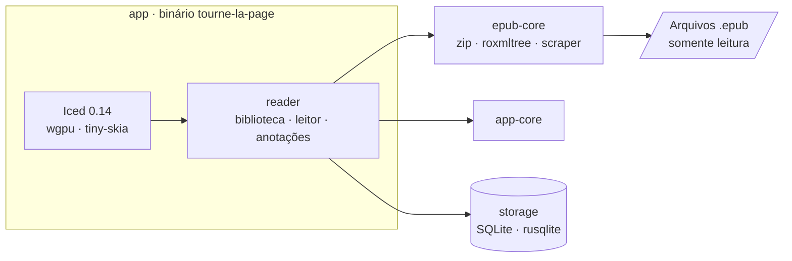

<!-- markdownlint-disable MD033 MD041 -->
<div align="center">

<a href="https://github.com/BrunodosSantosVaz/tourne-la-page">
  
</a>

# Tourne la page

**Menos ruído, mais leitura.**

Leitor EPUB nativo para **Windows, macOS e Linux**, escrito em Rust com Iced.<br>
Sua biblioteca fica no seu computador, e os seus livros nunca são modificados.

<br>

[](https://github.com/BrunodosSantosVaz/tourne-la-page/releases)
[](https://github.com/BrunodosSantosVaz/tourne-la-page/actions/workflows/bb-ci.yml)
[](https://github.com/BrunodosSantosVaz/tourne-la-page/actions/workflows/bb-codeql.yml)
[](LICENSE)
<br>
[](rust-toolchain.toml)
[](https://iced.rs)
[](crates/storage)
[](#-downloads)

<br>

<a href="https://github.com/BrunodosSantosVaz/tourne-la-page/releases"></a>
<a href="https://github.com/BrunodosSantosVaz/tourne-la-page/wiki/Uso"></a>
<a href="https://github.com/BrunodosSantosVaz/tourne-la-page/wiki"></a>
<a href="https://github.com/BrunodosSantosVaz/tourne-la-page/discussions"></a>

<br><br>


</div>

<!-- Capturas de tela: adicione imagens reais da Biblioteca e do Leitor em assets/screenshots/ e descomente.
<p align="center">
  
  
</p>
-->

<br>

<details>
<summary><b>Sumário</b></summary>

- [Por que Tourne la page](#-por-que-tourne-la-page)
- [Funcionalidades](#-funcionalidades)
- [Downloads](#-downloads)
- [Instalação](#-instalação)
- [Temas](#-temas)
- [Arquitetura](#-arquitetura)
- [Desenvolvimento](#-desenvolvimento)
- [Dados e privacidade](#-dados-e-privacidade)
- [Roadmap](#-roadmap)
- [Contribuindo](#-contribuindo)
- [Segurança](#-segurança)
- [Licença e créditos](#-licença-e-créditos)

</details>

## ✦ Por que Tourne la page

<table>
<tr>
<td width="33%" valign="top">

### 🦀 Nativo de verdade
Interface em Rust/Iced com renderização via `wgpu`, sem webview e sem Electron. Abre rápido e roda leve.

</td>
<td width="33%" valign="top">

### 🔒 Local por padrão
Biblioteca, progresso e anotações em SQLite no seu diretório de usuário. Nenhuma conta, nenhum servidor.

</td>
<td width="33%" valign="top">

### 📖 Seus EPUBs intactos
O aplicativo lê os arquivos e nunca os altera. Remover o app não apaga a sua biblioteca pessoal.

</td>
</tr>
</table>

## ✨ Funcionalidades

| | Biblioteca | | Leitura |
|:-:|---|:-:|---|
| 🖼️ | Capas, com capa substituta quando o livro não tem | 📜 | Leitura contínua com rolagem fluida e viewport virtualizado |
| 🔎 | Busca na biblioteca | 🧭 | Índice (sumário) do livro |
| ❤️ | Favoritos | ▶️ | Modo *play* com velocidade percentual |
| ⭐ | Avaliação por estrelas e detalhes do livro | 🔤 | Qualquer fonte instalada no computador, além de quatro sugestões |
| 💬 | Comentários pessoais por livro | 🎨 | Temas editáveis, com importação e exportação em JSON |
| 📊 | Progresso por livro e seção *Lendo* | 🖍️ | Destaques em cinco cores com comentários em post-its |

> [!NOTE]
> A série 0.x parte da versão aprovada em testes locais. Os limites conhecidos e os requisitos ainda pendentes estão documentados na [Wiki](https://github.com/BrunodosSantosVaz/tourne-la-page/wiki).

## 📦 Downloads

Pacotes portáteis compilados nativamente para cada plataforma, publicados em [Releases](https://github.com/BrunodosSantosVaz/tourne-la-page/releases). O aplicativo distribuído funciona sem Rust, Python ou checkout do repositório.

| Sistema | Arquitetura | Arquivo | Requisito mínimo |
|---|---|---|---|
|  | x64 · arm64 | `tourne-la-page-<versão>-windows-<arch>.zip` | — |
|  | x64 · arm64 (Apple Silicon) | `tourne-la-page-<versão>-macos-<arch>.zip` | macOS 12 |
|  | x64 · arm64 | `tourne-la-page-<versão>-linux-<arch>.tar.gz` | glibc 2.35 (Ubuntu 22.04+) |

Cada pacote inclui um `manifest.json` com o SHA-256 de todos os arquivos, verificado na esteira após extrair o pacote.

## 🚀 Instalação

<details open>
<summary><b>Windows</b></summary>

1. Baixe e extraia o `.zip`.
2. Abra `tourne-la-page.exe`.

</details>

<details>
<summary><b>macOS</b></summary>

1. Baixe e extraia o `.zip`.
2. Arraste **Tourne la page.app** para **Aplicativos**.

</details>

<details>
<summary><b>Linux</b></summary>

```bash
tar -xzf tourne-la-page-<versão>-linux-x64.tar.gz
cd Tourne-la-page
./AppRun

# Opcional: registra o atalho e os ícones no menu do sistema
python3 install.py
```

</details>

> [!IMPORTANT]
> Os pacotes ainda não têm certificado comercial. O sistema pode pedir autorização para abrir o aplicativo na primeira execução. Detalhes em [Como instalar](https://github.com/BrunodosSantosVaz/tourne-la-page/wiki/Uso).

## 🎨 Temas

Seis paletas prontas, um modo **Automático** que segue o sistema e temas personalizados editáveis em JSON.

| Tema | Fundo | Texto | Destaque |
|---|:-:|:-:|:-:|
| **Claro** |  `#FFFFFF` |  `#222222` |  `#1A4FB4` |
| **Papel** |  `#FCFBF7` |  `#2B2722` |  `#1A4FB4` |
| **Sépia** |  `#FAF7F0` |  `#342D22` |  `#7A4B12` |
| **Escuro** |  `#292A2D` |  `#D4D4D4` |  `#8AB4F8` |
| **Grafite** |  `#141516` |  `#DDDDDD` |  `#8AB4F8` |
| **Noite** |  `#000000` |  `#E6E6E6` |  `#8AB4F8` |

**Fontes sugeridas para o texto do livro:** Georgia, Literata, Atkinson Hyperlegible Next e Lexend, além de qualquer família instalada no sistema.

## 🏛️ Arquitetura

Workspace Cargo com quatro crates e dependências fixadas em versões exatas.



| Crate | Responsabilidade |
|---|---|
| [`app`](app) | Interface nativa, leitor, biblioteca, temas, fontes e identidade visual |
| [`epub-core`](crates/epub-core) | Abertura segura e leitura do conteúdo EPUB |
| [`storage`](crates/storage) | Persistência local em SQLite (WAL), pastas da biblioteca e preferências |
| [`app-core`](crates/app-core) | Tipos e regras compartilhados |

<details>
<summary><b>Stack completa</b></summary>

| Camada | Tecnologia |
|---|---|
| Linguagem | Rust 1.99.1 · edition 2024 |
| UI | `iced` 0.14 (wgpu, tiny-skia, svg, X11, Wayland) |
| EPUB | `zip` 9 · `roxmltree` 0.21 · `scraper` 0.27 |
| Dados | `rusqlite` 0.40 (SQLite embutido) |
| Imagens | `image` 0.25 (PNG, JPEG, WebP, GIF) |
| Fontes do sistema | `fontdb` 0.24 |
| Diálogos nativos | `rfd` 0.17 |
| Ícones | Lucide |
| Fontes da interface | Inter · Literata |

</details>

## 🛠️ Desenvolvimento

**Pré-requisitos:** [Rust via rustup](https://rustup.rs/) (a versão é fixada por `rust-toolchain.toml`) e Python 3.

```bash
git clone https://github.com/BrunodosSantosVaz/tourne-la-page.git
cd tourne-la-page
python3 local.py run
```

| Comando | O que faz |
|---|---|
| `python3 local.py run` | Compila e abre o app com dados locais isolados em `.local/tournepage` |
| `python3 local.py build` | Compila no perfil rápido de desenvolvimento |
| `python3 local.py check` | Verifica o workspace sem empacotar |
| `python3 local.py test [pacote]` | Roda os testes do workspace ou de um pacote |
| `python3 local.py clean` | Remove apenas o cache de build do Cargo |

<details>
<summary><b>Dependências de sistema no Linux</b></summary>

```bash
sudo apt-get install build-essential pkg-config libfontconfig1-dev libxkbcommon-dev \
  libwayland-dev libx11-dev libxcursor-dev libxi-dev libxrandr-dev \
  libgl1-mesa-dev libvulkan-dev
```

</details>

<details>
<summary><b>Gerar um pacote de distribuição</b></summary>

```bash
python3 scripts/package.py linux-x64   # linux-arm64 · windows-x64 · windows-arm64 · macos-x64 · macos-arm64
```

Cada alvo é compilado no seu sistema nativo. No Linux, o build roda em um contêiner Ubuntu 22.04 fixado por digest para garantir compatibilidade com glibc 2.35.

</details>

## 🔐 Dados e privacidade

- Biblioteca, preferências, progresso e anotações ficam em um banco SQLite no diretório do usuário.
- Os arquivos EPUB são abertos somente para leitura.
- Local, homologação e produção mantêm dados separados.

| Variável | Uso |
|---|---|
| `TOURNEPAGE_ENV` | Ambiente de execução (`local`, `homologacao`, produção) |
| `TOURNEPAGE_DATA_DIR` | Diretório alternativo para os dados |

Backup, variáveis e operação: [Wiki → Operação](https://github.com/BrunodosSantosVaz/tourne-la-page/wiki/Operacao).

## 🗺️ Roadmap

Acompanhe no [quadro público](https://github.com/users/BrunodosSantosVaz/projects/34).

- [x] Importação segura de EPUB e abertura progressiva
- [x] Rolagem fluida com viewport virtualizado
- [x] Fontes locais, temas editáveis e paletas
- [x] Destaques e comentários em post-its
- [x] Estrelas, favoritos, detalhes e progresso por livro
- [x] Release multiplataforma
- [ ] Renderização semântica completa de EPUB
- [ ] Posição exata com EPUB CFI e identidade estável
- [ ] Busca integral, coleções e biblioteca avançada
- [ ] Acessibilidade e seleção por teclado
- [ ] Exportação de anotações e backup/restauração
- [ ] Instaladores e assinatura comercial
- [ ] Desempenho em bibliotecas grandes e fuzzing
- [ ] Internacionalização e acabamento multiplataforma

## 🤝 Contribuindo

Contribuições são bem-vindas. O projeto é construído com o framework [Big Bang](https://github.com/BrunodosSantosVaz/big-bang): uma pessoa decide, IAs executam, e toda mudança passa por uma esteira com testes, revisão e homologação.

1. Procure ou abra uma [issue](https://github.com/BrunodosSantosVaz/tourne-la-page/issues) pelo formulário.
2. Crie uma branch a partir de `develop` (bugs a partir de `main`).
3. Use [Conventional Commits](https://www.conventionalcommits.org/pt-br/) em inglês. Issues, PRs e documentação em português do Brasil.
4. Abra o PR com *O que muda*, *Testes* e *Issue* (`Refs #n`). A CI precisa ficar verde.

Leia o [guia de contribuição](CONTRIBUTING.md), o [`AGENTS.md`](AGENTS.md) e o [código de conduta](CODE_OF_CONDUCT.md).

## 🛡️ Segurança

Não abra issue pública com detalhes de uma vulnerabilidade. Use o [relato privado](https://github.com/BrunodosSantosVaz/tourne-la-page/security/advisories/new) do GitHub. Veja a [política de segurança](SECURITY.md).

## 📄 Licença e créditos

Distribuído sob a licença [MIT](LICENSE). Fontes (Inter, Literata, Atkinson Hyperlegible, Lexend · OFL), ícones (Lucide · ISC) e dependências Rust têm seus avisos próprios incluídos nos pacotes.

<div align="center">

<br>


<sub>Desenvolvido por <a href="https://github.com/BrunodosSantosVaz">Bruno dos Santos Vaz</a></sub>

<br><br>

<a href="https://star-history.com/#BrunodosSantosVaz/tourne-la-page&Date">
  
</a>

<br>

<sub>Se o Tourne la page te ajuda a ler mais, deixe uma ⭐ no repositório.</sub>

</div>
