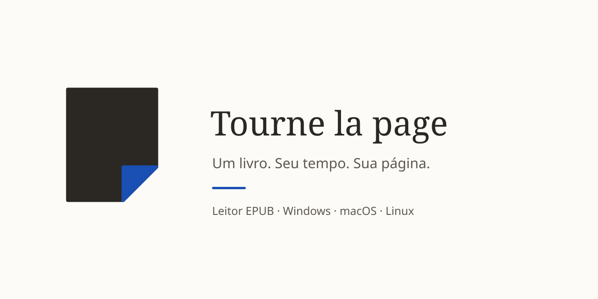

<!-- markdownlint-disable MD033 MD041 -->

# Tourne la page

**Menos ruído, mais leitura.**

Leitor EPUB nativo para **Windows, macOS e Linux**, escrito em Rust com Iced. 
Sua biblioteca fica no seu computador, e os seus livros nunca são modificados.

 

 

 

  

<!-- Capturas de tela: adicione imagens reais da Biblioteca e do Leitor em assets/screenshots/ e descomente.

  
  

-->

 

<b>Sumário</b>

- [Recursos](#-recursos)
- [Downloads e instalação](#-downloads-e-instalação)
- [Documentação](#-documentação)
- [Comunidade e segurança](#-comunidade-e-segurança)
- [Licença](#-licença)

## ✨ Recursos

<table>
<tr>
<td width="33%" valign="top">

### 📚 Biblioteca
Capas, busca, favoritos, avaliações e progresso de leitura.

</td>
<td width="33%" valign="top">

### 📖 Leitura
Rolagem contínua, índice, fontes do sistema, temas e marcações comentáveis.

</td>
<td width="33%" valign="top">

### 🔒 Privacidade
Aplicativo desktop em Rust/Iced. Livros e dados pessoais ficam no dispositivo.

</td>
</tr>
</table>

## 📦 Downloads e instalação

A versão estável [**v0.1.0**](https://github.com/BrunodosSantosVaz/tourne-la-page/releases/tag/v0.1.0) traz pacotes portáteis. Escolha seu sistema e arquitetura em [Releases](https://github.com/BrunodosSantosVaz/tourne-la-page/releases).

| Sistema | Arquitetura | Arquivo | Requisito mínimo |
|---|---|---|---|
| Windows | x64 · arm64 | `.zip` | — |
| macOS | x64 (Intel) · arm64 (Apple Silicon) | `.zip` | macOS 12 |
| Linux | x64 · arm64 | `.tar.gz` | glibc 2.35 (Ubuntu 22.04+) |

Confira os arquivos e seus checksums SHA-256 na página da release.

## 🧭 Documentação

| Guia | Conteúdo |
|---|---|
| [📖 Wiki](https://github.com/BrunodosSantosVaz/tourne-la-page/wiki) | Recursos, temas, instalação, arquitetura e limites conhecidos |
| [🛠️ Desenvolver](https://github.com/BrunodosSantosVaz/tourne-la-page/wiki/Uso) | Execução local, ferramentas e contribuição |
| [🗺️ Quadro público](https://github.com/users/BrunodosSantosVaz/projects/34) | Próximos passos do projeto |

## 🤝 Comunidade e segurança

Sugestões e dúvidas: [Discussions](https://github.com/BrunodosSantosVaz/tourne-la-page/discussions). Relate vulnerabilidades em particular pela [política de segurança](SECURITY.md).

## 📄 Licença

Licença [MIT](LICENSE). Avisos de fontes, ícones e dependências acompanham os pacotes.

 

Desenvolvido por <a href="https://github.com/BrunodosSantosVaz">Bruno dos Santos Vaz</a>

  

 

Se o Tourne la page te ajuda a ler mais, deixe uma ⭐ no repositório.

